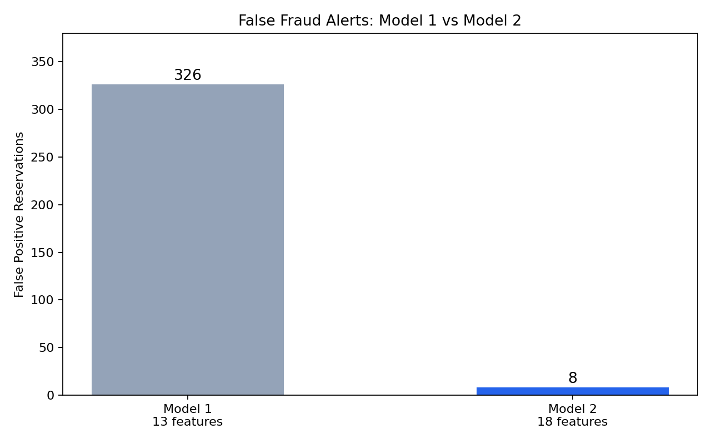

# Wyndham Fraud Risk Intelligence
### Loyalty Abuse and Reservation Fraud Detection

**Break Through Tech AI Studio Challenge Project — Fall 2026**

**Host Company:** Wyndham Hotels & Resorts  
**Team:** 1B

---

## 👥 Team Members

| Name | Email | Contributions |
|---|---|---|
| Amina Waqar | aminawaqar506@gmail.com | Project management, synthetic Revision 4 data ingestion and cleaning, QNS/QXY status code analysis, baseline modeling |
| Sweta Valisammagari | swetavalisammagari@gmail.com | Exploratory data analysis, points earned and velocity versus SRB redemption behavioral analysis, feature engineering |
| Kaden Phabmixay | Phabmixaykaden@gmail.com | Booking dynamics, lead time and length-of-stay feature engineering, PRD documentation, UI/UX dashboard wireframing |
| Sai | To be added | Decision tree evaluation, baseline comparisons, machine learning pipeline and tech stack integration |
---

## 🎯 Project Highlights

- Developed and evaluated machine learning models to identify suspicious reservations associated with Wyndham Rewards loyalty points abuse.
- Achieved **100% recall and 97.5% precision** with Model 2 on the May 2026 synthetic test data, detecting all 313 labeled fraud events with only 8 false positives.
- Reduced false positives by **97.5% compared with Model 1**, potentially reducing unnecessary manual reviews for Wyndham's fraud investigation team.
- Designed a fraud investigation dashboard prototype to help analysts review flagged reservations, understand risk indicators, and prioritize investigations.

These results are based on synthetic data and do not represent validated performance on real Wyndham reservations.

---

## 👩🏽‍💻 Setup and Installation

### 1. Clone the Repository

```bash
git clone https://github.com/Break-Through-Tech/Wyndham-1B-no-show-fraud-detection.git
cd Wyndham-1B-no-show-fraud-detection
```

### 2. Set Up the Python Environment

Python 3 and Git are required.

Create a virtual environment:

```bash
python -m venv .venv
```

Activate the environment.

**Windows PowerShell:**

```powershell
.\.venv\Scripts\Activate.ps1
```

**macOS/Linux:**

```bash
source .venv/bin/activate
```

Install the main Python dependencies:

```bash
pip install pandas numpy scikit-learn matplotlib seaborn pyarrow
```

Additional dependencies may be required for other team members' scripts.

### 3. Obtain the Dataset

The project uses Wyndham-provided Revision 4 synthetic reservation, stay, member, and fraud ground-truth datasets covering May, June, and July 2026.

The datasets are not included in the public repository. Authorized team members should obtain them through the approved project data-sharing process and place them in the appropriate local `data/` directory.

### 4. Run the Modeling Workflow

The main scripts are located in the `notebooks/` directory.

| Script | Purpose |
|---|---|
| `combined_data.py` | Combines monthly reservation and stay records |
| `data_cleaning.py` | Cleans and prepares the combined dataset |
| `model_data.py` | Creates the May modeling dataset and engineers features |
| `LogisticRegression.py` | Trains and evaluates the logistic regression models |

Run the scripts from the project root:

```bash
python notebooks/combined_data.py
python notebooks/data_cleaning.py
python notebooks/model_data.py
python notebooks/LogisticRegression.py
```

**Note:** The scripts require specific input datasets and generated Parquet files. Check the file paths before running. The full workflow has not yet been independently verified from a fresh clone.

### 5. Review the Results

Model evaluation metrics are printed in the terminal. Selected charts and analysis outputs are available in `outputs/feature_analysis/`.

**Dashboard Prototype:** [View Dashboard](https://www.figma.com/make/PbgRcuwq1nJcXpRNq2cE6X/Enterprise-Fraud-Dashboard-Design?fullscreen=1&t=jwXzps8SyGjixp9R-1&code-node-id=0-6)

The dashboard is currently a prototype. Connecting it to actual model predictions is part of the next development phase.

---

## 🏗️ Project Overview

This project is part of the Break Through Tech AI Studio program in partnership with Wyndham Hotels & Resorts.

Wyndham faces challenges with fraudulent reservations that exploit its loyalty rewards program. Suspicious activity can involve no-shows and late cancellations where points are earned despite the reservation not generating the expected room revenue. Those points may later be redeemed, creating financial losses and additional investigation work.

Our goal is to develop a machine learning approach that helps Wyndham identify potentially fraudulent activity earlier and gives its fraud investigation team a clearer way to review suspicious reservations.

Rather than relying only on manual spreadsheet reviews, the proposed system would process reservation data, assign fraud risk scores, and present relevant information through an analyst dashboard.

### Business Impact

Earlier detection could help Wyndham prevent the redemption of improperly earned points, reduce unnecessary investigations, and allow analysts to focus on higher-risk reservations.

The dashboard is intended to support human decision-making rather than automatically penalize customers.

---

## 📊 Data Exploration

We worked with Wyndham's Revision 4 synthetic dataset covering May, June, and July 2026.

The combined reservation dataset contains approximately **9.6 million records**, with 3.2 million records per month.

Our analysis focused on understanding which reservation and loyalty account behaviors were associated with labeled fraud events.

### Areas Explored

- Booking lead time, length of stay, and same-day reservations.
- Member account age and previous reservation activity.
- No-show (QNS) and late-cancellation (QXY) qualification codes.
- Loyalty points earned, redemption activity, and room revenue.
- Booking channels and rate codes.

### Data Challenges

We investigated inconsistencies in the synthetic data, particularly fraud member enrollment dates repeated across months.

This may affect the reliability of June and July validation and needs to be addressed before drawing conclusions from those months.

---

## 🧠 Model Development

We developed two logistic regression approaches to compare fraud detection at different points in the reservation process.

### Model 1 — Booking-Time Detection

Uses information available around the time of booking, such as lead time, account tenure, booking channel, and reservation history.

Its purpose is to identify potentially suspicious reservations before the stay occurs.

### Model 2 — Post-Stay, Pre-Redemption Detection

Uses 18 features, including reservation history, qualification codes, points earned, and room revenue.

This model focuses on detecting suspicious activity after stay information and loyalty points have posted, but before those points are redeemed.

Wyndham confirmed that these post-stay fields are available together at this stage, making Model 2 particularly relevant to the intended fraud review workflow.

### Training and Evaluation

For evaluation, we used a member-disjoint training and testing split within the May 2026 synthetic dataset to avoid having the same members in both sets.

---

## 📈 Results and Key Findings

### Model Performance — May 2026 Test Data

The held-out test set contained **641,020 reservations**, including **313 labeled fraud events**.

| Metric | Model 1 | Model 2 |
|---|---:|---:|
| Precision | 48.98% | 97.51% |
| Recall | 100% | 100% |
| F1 Score | 65.75% | 98.74% |
| True Positives | 313 | 313 |
| False Positives | 326 | 8 |
| False Negatives | 0 | 0 |

Both models detected all 313 labeled fraud events in the test set. However, Model 2 generated substantially fewer false positives.

This difference matters because every false positive could require an analyst to spend time investigating a legitimate reservation. Reducing unnecessary alerts could make the fraud review process more efficient.

Model 2's stronger results may be partly explained by the additional post-stay information it uses.

### Model Comparison



### Limitations

The results are promising, but the data is synthetic and may contain patterns that make fraud easier to identify than it would be in real customer activity.

We have not yet established how well these models would perform on real Wyndham data. Additional validation is necessary before considering operational use.

---

## 🚀 Next Steps

Our next focus is connecting the existing trained model to the dashboard.

Planned work includes:

- Saving and loading the trained model so it can generate predictions without retraining each time.
- Building a workflow to process new reservation spreadsheets and return fraud risk predictions to the dashboard.
- Working with Wyndham stakeholders to identify which reservation details and investigation actions analysts need.
- Validating the model with improved synthetic data and, if available and authorized, representative real-world data.
- Evaluating a practical schedule for processing new reservations without placing unnecessary load on Wyndham's systems.

Longer-term improvements could include historical behavior across properties, additional fraud patterns, model monitoring, and using reviewed analyst feedback to improve future versions.

---

## 📝 License

License selection is pending team and Challenge Advisor approval.

---

## 🙏 Acknowledgements

We would like to thank **Wyndham Hotels & Resorts**, our Challenge Advisors **Danielle Golinski and Seema Yadav**, our AI Studio Coach **Deanna DiMonte**, and the Break Through Tech AI Studio team for their guidance and support throughout the project.

